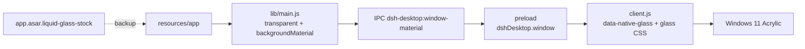

<p align="center">
  
</p>

<h1 align="center">DSH Liquid Glass</h1>

<p align="center">
  Windows 11 Acrylic liquid-glass skin for <b>DeepSeek Harness Desktop</b>.<br>
  Live desktop transparency, borderless glass surfaces, B-only — no wallpaper, no wallpaper fallback.
</p>

<p align="center">
  <code>Windows 11 22H2+</code> · <code>DSH Desktop 0.2.2-rc.1</code> · <code>Electron 44</code> · <code>MIT</code>
</p>

---

## What it does

- The main window uses the native **Windows 11 Acrylic / Mica** material. The desktop, desktop icons, and windows behind it show through live.
- Every page, sidebar, settings panel, menu, and dialog becomes translucent glass with a hairline edge.
- Settings → **Liquid Glass**: real-desktop switch, Acrylic / Mica / Clear, glass veil, blur, density, saturation, radius, grain, presets.
- The window is **borderless**; the native Windows 11 corners and the Acrylic material carry the shape.
- **B-only by design**: no wallpaper route, no wallpaper source, no image fallback. If the desktop shell patch is missing, the settings page says so and the switch is disabled.

## What it does not do

- It does not read or display your Windows wallpaper.
- It does not bundle or modify `DeepSeek Harness.exe`, its signature, or the installer.
- It does not replace the host theme; it layers a glass skin over it.

## Requirements

| Item | Value |
| --- | --- |
| OS | Windows 11 22H2 or newer (Acrylic) |
| DSH Desktop | `0.2.2-rc.1` (Electron 44) |
| Install dir | e.g. `D:\dsh` or `%LOCALAPPDATA%\Programs\DeepSeek Harness` |
| Patch | `desktop-patch/` in this repo (required for the live desktop material) |

The desktop patch targets the Electron 44 / DSH Desktop `0.2.2-rc.1` layout. Before running it, check the fuses with `desktop-patch\tools\check-fuses.mjs`; `EnableEmbeddedAsarIntegrityValidation` and `OnlyLoadAppFromAsar` must both be **off** (the target build has `states=101100011`). If they are not, stop.

## Install

### 1. Install the plugin

In DSH: **Settings → Plugins** → install a local bundle, and pick this repository directory. Or ask your DSH agent to install it:

```text
plugin_manager install_bundle "C:\path\to\dsh-liquid-glass"
```

The plugin is a normal DSH bundle (`cordis.patch.yml` + `client.js`). It will show “Desktop shell patch required” until step 2 is done. It never falls back to a wallpaper.

### 2. Prepare the patched app

From the repository root (the app may stay open):

```powershell
node .\desktop-patch\scripts\extract-and-patch.mjs --install-dir "D:\dsh"
```

No global Node? Use the bundled one:

```powershell
& "D:\dsh\resources\runtime\primary-runtime\dependencies\node\bin\node.exe" `
  ".\desktop-patch\scripts\extract-and-patch.mjs" --install-dir "D:\dsh"
```

This extracts 22k files into `resources\app` and patches `lib/main.js` / `lib/preload-app.cjs`. It does not touch `app.asar` yet. On failure it removes the generated `resources\app`.

### 3. Apply

**Double-click** `desktop-patch\apply.cmd` from Explorer. Do not run it from the DSH terminal — DSH is killed during the switch.

The script auto-detects the install dir from the running app. If the app is closed:

```powershell
.\desktop-patch\apply.cmd -InstallDir "D:\dsh"
```

It waits 20 s, kills + renames `app.asar` → `app.asar.liquid-glass-stock` in a tight loop, and restarts from `resources\app`. If the app exits during startup, it **auto-rolls back**.

### 4. Check

```powershell
.\desktop-patch\verify.cmd
```

Then open **Settings → 液态玻璃 / Liquid Glass**, enable **Real desktop transparency**, and pick **Acrylic**.

## How it works



- `createWindow(..., primary)` gets `titleBarStyle: "hidden"`, transparent `titleBarOverlay`, `backgroundColor: "#00000000"`, `backgroundMaterial: "acrylic"`.
- The IPC handler validates the main frame and `dsh-app://app/` URL, then calls `setBackgroundMaterial`.
- The preload exposes `window.dshDesktop.window.getMaterial/setMaterial`.
- The plugin adds `data-native-glass`, sets `body::before` to the scrim only, draws no window border, and overrides the host background tokens.
- Disabling the plugin calls `setMaterial("none")`, removes `data-native-glass` and the tokens, and restores the host.

## Repository layout

```text
.
├─ client.js                 # B-only client: native material runtime + settings + CSS
├─ index.js                  # Host half: intentionally no-op (no wallpaper route)
├─ cordis.patch.yml          # bundle patch
├─ locale/                   # zh / en display metadata
├─ icon.svg
├─ docs/
│  ├─ true-desktop.md        # architecture / acceptance notes
│  ├─ verification.md        # sanitized verification record
│  └─ screenshots/           # add your own; do not upload personal desktop data
└─ desktop-patch/
   ├─ apply.cmd / revert.cmd / verify.cmd
   ├─ scripts/
   │  ├─ extract-and-patch.mjs
   │  ├─ apply.ps1
   │  ├─ revert.ps1
   │  ├─ verify.ps1
   │  └─ capture-after.ps1
   └─ tools/
      ├─ asar.mjs
      └─ check-fuses.mjs
```

## Revert

Double-click `desktop-patch\revert.cmd` (or pass `-InstallDir`). It restores `app.asar`, moves `resources\app` to `app.liquid-glass-unpacked-<timestamp>`, and starts the stock app. Then remove the plugin in DSH if you no longer want it.

## Update DSH Desktop

An update rebuilds `app.asar`. After updating:

1. `revert.cmd` if the app is currently patched.
2. Re-run `extract-and-patch.mjs` against the new `app.asar`.
3. Re-run `apply.cmd`.

The plugin detects the missing API and only shows the patch hint — it never falls back to a wallpaper.

## Troubleshooting

| Symptom | Fix |
| --- | --- |
| App does not come back after apply | Run `desktop-patch\revert.cmd`; check `resources\liquid-glass-apply.log`. The apply script auto-rolls back if the process exits within 15 s. |
| “Desktop shell patch required” | Step 2/3 not done, or the app is still running from `app.asar`. Check the apply log for `host runtime loaded from resources\app\dsh`. |
| No “Liquid Glass” settings entry | The settings trigger is at the bottom of the sidebar; at a short window height it can be clipped — maximize the window, or restart after install. |
| Acrylic looks flat | Windows 11 22H2+ and a working GPU driver are required. Try Mica or Clear; check that the renderer `--app-path` is `...\resources\app`, not `app.asar`. |
| `apply.cmd` says it is running under DSH | Launch it from Explorer or an external terminal, not from the DSH built-in terminal. |
| Version unsupported | The patch targets `0.2.2-rc.1`; `extract-and-patch` aborts safely on other versions. Open an issue with the version. |

## Privacy

- The plugin makes **no network requests** and does not read the wallpaper, registry, or files.
- The only bridge is the local `dsh-desktop:window-material` IPC to the desktop shell.
- The desktop patch is local-only; it edits `resources` and keeps a stock backup.

## Credits & license

- MIT — see [LICENSE](LICENSE).
- Unofficial community project; **not affiliated with DeepSeek**.
- Targets the MIT-licensed `@deepseek-ai/dsh-desktop` package. No DSH Desktop application archive or executable is redistributed.
- See [NOTICE.md](NOTICE.md) for the unofficial-project and redistribution note.
- Built for [DeepSeek Harness](https://github.com/deepseek-ai).
